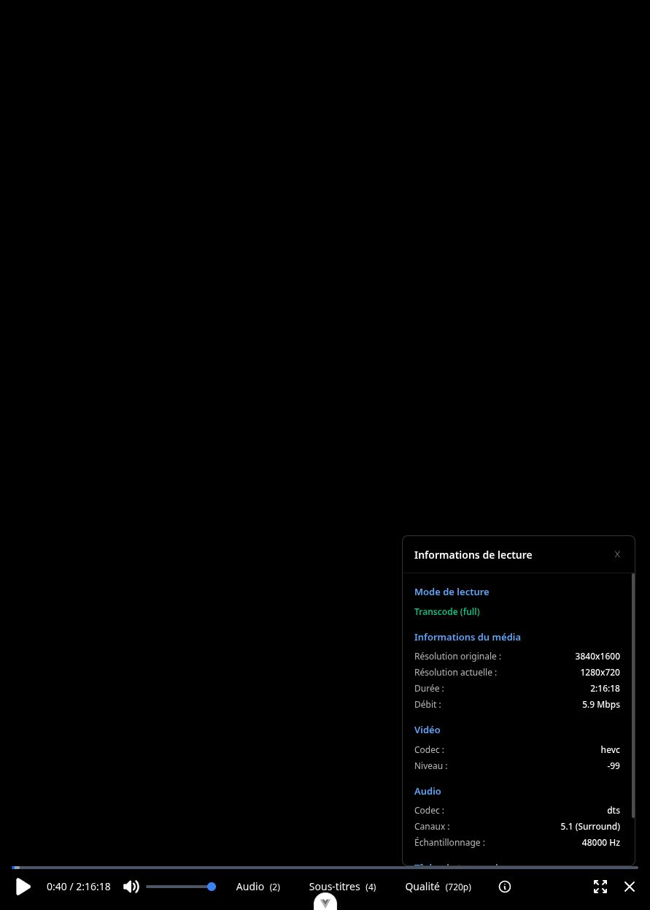

# Ferelix — architecture et fiabilité du lecteur

Audit du 6 novembre 2026, référence `cf3248ca49e300b5d9f08fd74061f60b173b97f6`. Les corrections sont locales, sans commit ni déploiement. Les fichiers `dev/start.mjs` et `dev/guardian*`, déjà modifiés avant l'audit, ont été préservés.

Le principal problème était la gestion du cycle de vie : décisions de lecture réutilisées après changement de piste, opérations concurrentes, encodeurs survivant à la session et verrou SQLite pendant les analyses. Le lot corrige ces causes et réduit le coût de la lecture directe. Il ne revendique aucune accélération du calcul d'encodage FFmpeg.

## Mesures avant et après

Les [résultats bruts](measurements.json) contiennent les échantillons et l'environnement. Machine : Ryzen 5 PRO 8640HS, Python 3.15.2, FFmpeg 8.1.3. Les essais réels utilisent les films existants en lecture seule, une copie temporaire de la base et un compte de test isolé.

| Modification | Scénario et problème initial | Résultat corrigé |
|---|---|---|
| Lecture directe par blocs de 256 Kio au lieu de 8 Kio | 7 transferts HTTP des mêmes 128 Mio en cache, un client local : médiane CPU serveur 0,45 s ; temps écoulé 0,447 s | CPU 0,06–0,07 s (**−84 à −87 %**) ; temps 0,099–0,108 s (**−76 à −78 %**) |
| Fermeture de session propriétaire de ses jobs | Vrai remux HEVC/fMP4 et vrai transcode libx264/AAC 720p : après DELETE session, 1 FFmpeg continuait dans chacun des deux essais | 0 FFmpeg après DELETE ; arrêt complet en 0,270 s et 0,378 s respectivement |
| Sérialisation et suppression des intentions dépassées | Test simulé : 20 déplacements pendant une création de flux lente provoquaient 20 jobs de remplacement | 2 remplacements : celui déjà parti et le dernier demandé, soit **−90 % de créations** dans ce test |
| Horloge absolue commune | Test HLS démarré à 600 s, lecture +12 s puis passage en direct : reprise à 12 s | Reprise à 612 s |
| Extraction avant transaction d'écriture du scanner | SQLite sur disque, deux connexions, deuxième ffprobe bloqué artificiellement : 5/5 écritures concurrentes échouent après ~204 ms (timeout fixé à 200 ms) | 5/5 réussissent avant libération du ffprobe, médiane 0,64 ms |
| Négociation selon conteneur réel | WebM VP8/Vorbis déclaré compatible envoyé en transcode complet | DirectPlay, aucun encodeur requis dans le plan testé |
| Négociation selon audio choisi | Plan basé sur la première piste, indépendamment du choix utilisateur | AAC compatible → remux ; DTS incompatible → vidéo copiée/audio transcodé ; retour AAC → remux |

Une seconde série de sept transferts sur la version finale donne 0,07 s CPU et 0,108 s écoulées ; la fourchette ci-dessus inclut les deux séries après correction. Le CPU HTTP est celui du processus serveur, mesuré avec `/proc`, avec une résolution de 10 ms ; le client HTTP est exclu. Cette mesure sur fichier en cache et boucle locale ne prédit ni le débit d'un réseau domestique, ni la consommation totale de lecture, ni le coût de décodage du navigateur. Les blocs consomment au plus 256 Kio par lecture au lieu de 8 Kio : la réduction des passages par le pool de threads explique le gain.

Le microbenchmark de la boucle de lecture donne 0,424 → 0,024 s CPU, mais le chiffre HTTP ci-dessus est la mesure la plus représentative de l'API. Le transfert exact des plages, les fins partielles et les fichiers tronqués sont couverts par des tests.

Le délai de première playlist n'est pas amélioré dans ces deux essais : remux 0,216 → 0,392 s ; transcode 720p 2,443 → 2,472 s. Un seul essai par cas ne permet pas une conclusion statistique sur ce délai. L'amélioration démontrée est l'arrêt effectif, pas un démarrage plus rapide.

## Corrections de fiabilité

### Une intention de lecture et une exécution ordonnée

Les six chemins de démarrage/reprise du lecteur partagent maintenant une orchestration qui arrête l'ancien job, démarre le nouveau, attend ses fichiers et attache la source. Une opération dépassée ne peut plus remplacer la source courante. Les requêtes de mutation déjà envoyées sont suivies pour récupérer puis arrêter leur éventuel job ; les lectures et attentes de readiness sont annulables.

Les tests reproduisent la fermeture pendant une négociation, les réponses tardives, le changement de qualité en pause, les callbacks d'anciennes instances HLS et les sous-titres réapparaissant après désactivation. La position absolue et la pause sont conservées. Le menu de sélection reste visible au-delà des trois secondes d'auto-masquage des contrôles. Le panneau d'informations ne recouvre plus les menus : le clic qualité, auparavant intercepté dans le navigateur réel, sélectionne maintenant 720p. Un bouton de fermeture reste accessible sur l'écran d'erreur, vérifié lui aussi dans le navigateur. L'instance HLS reste dans un `shallowRef` et ses callbacks vérifient son identité.

La relecture croisée a ajouté trois régressions d'interaction : audio DTS puis seek avant réponse, qualité 720p puis seek avant réponse, et sous-titre PGS depuis un plan remux `copy/copy`. Les deux premiers conservent désormais l'intention audio/qualité actuelle ; le dernier impose réellement H.264 au lieu de demander une copie vidéo incompatible avec l'incrustation. Les trois tests ont d'abord échoué puis passé après correction.

La négociation reçoit `AudioStreamIndex`, choisit explicitement la piste ou sa valeur par défaut et rejette un index inexistant. Le plan puis le démarrage automatique utilisent la même sélection. Les types OpenAPI/TypeScript sont régénérés. Les requêtes HLS.js locales réutilisent le jeton actuel au lieu de conserver celui de l'URL initiale.

### Une session propriétaire de ses encodeurs

Fermer une session arrête tous ses jobs, y compris un démarrage dont la réponse n'a jamais atteint le navigateur. Une session terminée ne peut plus démarrer un nouveau job. Des transitions conditionnelles empêchent une fin de moniteur de réécrire un job annulé comme terminé ou échoué. Un stdin cassé, une erreur de moniteur ou son annulation ne laissent plus un processus sans surveillance : l'arrêt tue et récolte le processus si nécessaire.

Le bail d'activité est renouvelé par le client, plus par la progression FFmpeg. Le heartbeat protège aussi les fichiers d'une lecture en pause. Le nettoyage passe toutes les minutes avec un bail de dix minutes : après disparition silencieuse du client, la borne nominale devient **10–11 minutes**, sous réserve de disponibilité du scheduler et de la base. Une fermeture explicite utilise l'arrêt immédiat mesuré plus haut.

La readiness fMP4 vérifie la présence de l'initialisation et du premier segment. Les suppressions concurrentes de fichiers ne provoquent plus une exception de vérification. Les endpoints HLS et le heartbeat contrôlent le propriétaire des sessions explicites.

Le nettoyage revendique atomiquement un job en `STOPPING` seulement si son bail actuel reste expiré. La transaction est validée avant l'attente du processus. Un heartbeat reçu pendant le nettoyage du job précédent protège ainsi une lecture qui vient de reprendre ; deux interleavings running/completed reproduisent ce cas. Un arrêt échoué conserve la ligne, le PID et les chemins pour réessayer, et les renouvellements après revendication reçoivent HTTP 410.

La méthode inutilisée `cleanup_previous_sessions`, qui aurait arrêté les jobs de tous les spectateurs d'un même film, a été supprimée après vérification de l'absence d'appel.

### Scanner et lecture peuvent progresser ensemble

L'analyse et la vignette sont produites avant les écritures ; les résultats analysés sont commités immédiatement. Les mises à jour peu coûteuses des fichiers inchangés restent groupées. Le scanner ne garde donc plus le verrou d'écriture pendant les subprocessus suivants. Cela augmente le nombre de commits des fichiers analysés : **aucune accélération globale du scan n'est revendiquée**.

Les scans simultanés de la même bibliothèque sont dédupliqués dans le processus scheduler. Ce mécanisme suppose le serveur à un worker actuellement utilisé ; ce n'est pas un verrou distribué.

## Architecture recommandée ensuite

1. **Finir l'autorité des sessions côté serveur.** Rendre obligatoire une session avec propriétaire pour tous les chemins de lecture. Les anciens démarrages sans vraie `PlaybackSession` restent accessibles à un utilisateur authentifié connaissant l'UUID du job. Versionner les intentions de flux côté serveur permettra aussi de rejeter les mutations obsolètes issues d'autres clients. Conserver un plan de lecture explicite : pistes, qualité, méthode, encodeurs, offset et raisons ; le front applique ce plan.

2. **Réguler l'avance d'encodage.** FFmpeg peut encore encoder bien plus loin que le spectateur, notamment en pause. Introduire une borne d'avance et une reprise avec hystérésis, puis mesurer secondes encodées inutiles, CPU/GPU, octets HLS et délai de reprise. Jellyfin compare l'avance encodée à l'activité de téléchargement dans son [TranscodingThrottler](https://github.com/jellyfin/jellyfin/blob/6a5a910d1b182400b3f026226fc099f3a0ec8b51/MediaBrowser.Controller/MediaEncoding/TranscodingThrottler.cs). Il faut vérifier les possibilités du FFmpeg installé avant de reprendre sa mécanique de pause. Aucun pourcentage de gain anticipé n'est présenté comme acquis.

3. **Achever le contrat d'authentification du média.** Le renouvellement est corrigé pour HLS.js. Les URL DirectPlay et HLS natif restent figées : leur jeton peut expirer pendant un long film. Prévoir une autorisation de média limitée à la session et renouvelable, sans allonger simplement les privilèges généraux du compte. Les mutations réseau start/stop n'ont pas encore une deadline globale : la file sérialisée peut attendre une requête qui ne se termine pas. Traiter explicitement l'issue inconnue et fermer sa session avant de relancer.

4. **Séparer les responsabilités à leurs frontières utiles.** Extraire ensuite l'état et les effets de lecture dans un composable dédié, en conservant les contrôles/overlays existants. Le contrat plan/exécution sépare décisions de compatibilité et supervision FFmpeg. Scinder le dashboard par domaines partageant leurs invariants (identité, bibliothèque/jobs, observabilité). Ces changements visent une réduction des divergences et des scénarios à tester ; déplacer des lignes n'accélère pas le runtime.

5. **Alléger le catalogue.** `LibraryView` attend actuellement le chargement de tous les éléments alors que l'onglet initial affiche des recommandations. Un catalogue de 10 000 médias déclenche 101 requêtes paginées selon le code actuel (calcul, non benchmark). Charger l'onglet catalogue à la demande, paginer son affichage et séparer un DTO carte léger des pistes détaillées. La homepage effectue aussi des requêtes par rangée qui peuvent être groupées. Mesurer requêtes SQL, taille JSON et temps d'affichage avec une bibliothèque représentative.

## Autres défauts détectés et non corrigés dans ce lot

| Priorité | Constat | Correction proposée et preuve à ajouter |
|---|---|---|
| Haute | Changer/réinitialiser un mot de passe ne révoque pas les refresh tokens ; leur renouvellement prolonge l'accès | Service commun de changement de credentials et suppression des refresh tokens dans la même transaction ; test ancien refresh refusé après reset |
| Moyenne | Unicité username sensible à la casse en DB, recherches de connexion insensibles ; email sans contrainte équivalente | Audit des collisions puis contrainte normalisée ; test créations concurrentes |
| Moyenne | Menu de piste vidéo de `MediaDetailView` sans transmission jusqu'au mapping FFmpeg | Chaîne typée `VideoStreamIndex`, test fichier à deux pistes ; rendre la présentation non interactive en attendant |
| Moyenne | Un ffprobe échoué retourne `{}` et peut remplacer des pistes valides lors d'un rescan | Résultat d'extraction succès/échec explicite ; conserver le dernier snapshot valide et exposer l'erreur |
| Moyenne | Fin normale d'un scan annulé réécrit son historique comme « success » ; états UUID non purgés | Tracker respectant les états terminaux métier et purge bornée ; test annulation conservée |
| Moyenne | Certaines capacités/options déclarées ne sont pas réellement appliquées (`VideoCodecTag`, `Allow*StreamCopy`, inférence HDR/10-bit) | Matrice codec/profil/conteneur/transport et erreur explicite lorsqu'aucune méthode autorisée ne convient |

Le serveur possède ses processus et son scheduler en mémoire. Il faut assumer et documenter un worker tant qu'une propriété persistante des tâches n'existe pas ; multiplier les workers ne constitue pas une optimisation sûre actuellement.

## Comparaison Jellyfin

Les invariants utiles ont été consultés dans les dépôts officiels à des commits fixés :

- [MediaInfoHelper](https://github.com/jellyfin/jellyfin/blob/6a5a910d1b182400b3f026226fc099f3a0ec8b51/Jellyfin.Api/Helpers/MediaInfoHelper.cs#L267-L283) : négociation serveur et attribution d'une session/position.
- [TranscodeManager](https://github.com/jellyfin/jellyfin/blob/6a5a910d1b182400b3f026226fc099f3a0ec8b51/MediaBrowser.MediaEncoding/Transcoding/TranscodeManager.cs#L135-L235) : activité du client associée à sa session et arrêt avant nettoyage. Ferelix conserve ici ses propres délais, pas le bail HLS de 60 secondes de cette implémentation.
- [PlaybackManager web](https://github.com/jellyfin/jellyfin-web/blob/802085cf95c42af5bb66f476347a8727529d30f5/src/components/playback/playbackmanager.js#L1710-L1799) : renégociation du profil, des pistes et de la position lors d'un changement de flux.

## Validation et reproduction

La base initiale passait 207 tests serveur et 40 tests web. Les nouveaux tests ont également été exécutés contre le code initial pour démontrer les échecs, et pas seulement contre les corrections. Validation finale : **260 tests serveur, 62 tests web et 4 tests du lanceur passent** ; Ruff, basedpyright, vue-tsc, génération OpenAPI/TypeScript, build web et `git diff --check` passent. Le build conserve son avertissement de bundle principal proche de 979 ko. La même sélection initiale de 36 tests lifecycle serveur échoue dans 24 scénarios sur HEAD et passe entièrement après correction ; les 19 tests lecteur web comparés à HEAD donnent 16 échecs avant, tous verts après. Des cas supplémentaires ont été ajoutés lors des relectures, notamment bail renouvelé pendant nettoyage et enchaînements audio/qualité/seek.

Les tests de régression se trouvent notamment dans `test_playback_lifecycle.py`, `test_transcoder_lifecycle.py`, `test_scanner_concurrency.py`, `test_stream_builder.py`, `test_range_reader.py`, `CustomVideoPlayer.spec.ts` et `playerPlayback.spec.ts`.

Depuis la racine :

```bash
source "$HOME/.nvm/nvm.sh"
nvm use
pnpm test
pnpm type-check
pnpm build
```

Depuis `server`, le benchmark de lecture est relançable sans FFmpeg ni écriture DB :

```bash
uv run python -m scripts.benchmark_streaming /chemin/vers/un/film.mkv
```

Pour la mesure HTTP, utiliser une instance locale au repos et fournir son PID et un jeton dans `FERELIX_BENCHMARK_TOKEN` (jamais imprimé par le script) :

```bash
uv run python -m scripts.benchmark_http_streaming --media-id 1 --server-pid PID
```

Les essais API réels sont bornés à 30 secondes avec arrêt forcé ciblé à 35 secondes en secours. Les essais navigateur disposent d'un arrêt automatique après 25 secondes d'encodeur, porté à 45 secondes pour le dernier parcours incluant plusieurs changements de flux. Les contrôles de processus vérifient l'absence de FFmpeg après chaque essai. Les mesures CPU ne tournent pas en parallèle des transcodes.

L'audit couvre les sources backend et web disponibles, leurs tests, le lancement local et une lecture vidéo réelle. Les fichiers source Android TV ne sont pas présents dans ce checkout, seulement des résidus de build ; le client n'a donc pas été audité. Safari, les profils TV, HDR matériel et une lecture d'un film entier ne sont pas validés par ces essais courts.

La vérification navigateur finale a repris le film à 18 s, appliqué 720p, choisi la seconde piste DTS (mapping FFmpeg `0:2`, audio réencodé AAC), puis observé la progression jusqu’à 40 s. Le lecteur conserve l’aspect du film dans la cible 1280×720. La capture suivante montre les contrôles en pause après ces changements ; elle ne constitue pas une mesure de qualité d’image ou de son.


