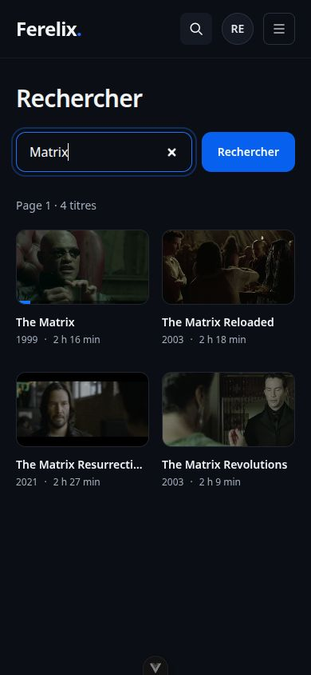
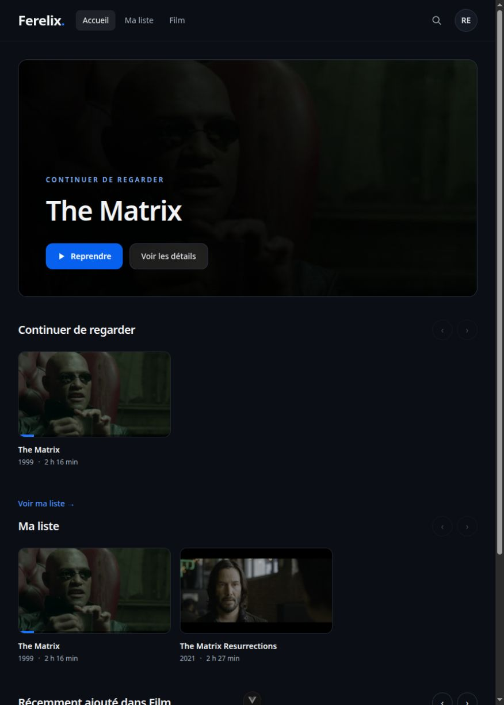

# Ferelix — découverte et préférences personnelles

Cette seconde PR se base sur `codex/playback-architecture-ux` (PR #6), pas directement sur `main`. Elle ajoute trois fonctionnalités au socle fiabilisé : recherche globale, Ma liste et préférences audio/sous-titres. Le [rapport précédent](review.md) contient les comparaisons de performance du premier lot.

## Fonctions livrées

- **Recherche globale** dans les bibliothèques actives, indépendante des cartes déjà chargées. Saisie temporisée de 300 ms, anciennes requêtes annulées/ignorées, 48 résultats par page, état vide/erreur et nouvelle tentative. La requête et la page restent dans l'URL et sont conservées au retour d'une fiche.
- **Ma liste personnelle**, avec ajout/retrait depuis une fiche, page dédiée et rangée sur l'accueil. L'interface confirme la réponse serveur avant de changer l'état. Une contrainte unique empêche les doublons, y compris entre requêtes concurrentes.
- **Préférences de lecture** : langue audio, langue des sous-titres, désactivés/forcés/toujours si disponibles. Le serveur résout les langues et choisit les pistes une fois à l'ouverture ; les choix explicites du lecteur restent prioritaires pendant les changements de qualité et déplacements. `-1` signifie explicitement aucun sous-titre. [Contrat et replis](../../playback-preferences.md).

Les métadonnées détaillées restent chargées à la demande. L'état Ma liste est projeté dans la requête SQL des cartes et de la fiche, sans requête supplémentaire par film. Les sous-titres texte sont extraits en VTT ; une piste image sélectionnée provoque un plan de transcodage avec le bon index de superposition. Si ce traitement est interdit, le serveur renvoie explicitement l'absence de méthode compatible.

## Mesures et preuves

| Scénario exécuté | Résultat |
| --- | --- |
| Catalogue synthétique de 10 000 films, recherche du dernier titre | Film 10 000 retrouvé ; 2 requêtes SQL auth comprise ; 266 octets JSON ; médiane 5,867 ms sur 7 essais locaux après échauffement |
| Recherche large, fenêtre de 49 cartes pour afficher 48 et détecter la suite | 2 requêtes SQL ; 16 150 octets JSON ; médiane 3,390 ms |
| 8 ajouts simultanés du même film via HTTP, connexions DB séparées | 8 réponses 200, une seule entrée persistée |
| Deux comptes sur la copie de la bibliothèque réelle | Ma liste du second compte reste vide après les ajouts du premier ; DELETE répété retourne bien l'état absent |
| Négociation sur The Matrix Reloaded | Préférence anglais → audio 2 ; français « toujours » → texte 3 ; image explicite 5 → Encode ; audio 1 et sous-titres -1 explicites restent prioritaires |
| Langue absente / forcés absents | Repli sur l'audio par défaut / aucun sous-titre non forcé sélectionné en mode forcé |

[Échantillons du benchmark](discovery.json), [scénarios HTTP réels](features-http.json), [script reproductible](../../../server/scripts/benchmark_discovery.py). Ces nouvelles API n'avaient pas d'équivalent avant : les durées ci-dessus sont des mesures absolues locales, sans comparaison CPU ni promesse de latence en production.

## Correction des sous-titres déclenchée par cette fonctionnalité

Avant, FFmpeg écrivait directement dans le nom de cache final. Une seconde demande pouvait lire un VTT partiel ; un échec pouvait laisser ce résultat réutilisé indéfiniment. L'extraction n'avait pas de délai maximal ni de récupération du processus lors d'une annulation.

Après, un verrou par cible déduplique les extractions, un fichier temporaire n'est publié par remplacement atomique qu'après succès, et l'attente/extraction est limitée à 30 secondes. Timeout et annulation tuent et récupèrent le processus. Le cache utilise le chemin, la taille et la date de modification du fichier source ; le nouveau format ignore les anciens caches potentiellement incomplets. Cette coordination suit le contrat mono-worker du serveur.

**6 tests de régression échouaient sur l'ancien code. 10 tests ciblés passent après correction**, couvrant demandes concurrentes, publication atomique, réutilisation, annulation pendant lancement/extraction, timeout, sortie vide/invalide, échec suivi d'un nouvel essai, invalidation par taille ou date. Une extraction réelle SRT → VTT est bornée à cinq secondes. Il s'agit d'une preuve de comportement, pas d'une mesure de gain CPU.

## Vérification navigateur et lecture réelle

Sur une copie isolée de la base réelle, avec deux comptes de test : recherche « Resurrections », ouverture de fiche, retrait/ajout, retour conservant la recherche, page Ma liste et sauvegarde des préférences conservée après rechargement. À 390 × 844 px, la recherche affiche les quatre films sans débordement horizontal (largeur du document : 390 px).

La lecture automatique de The Matrix Reloaded a sélectionné audio 2 (anglais/DTS) et sous-titre 3 (français). Le vrai lancement FFmpeg contenait `-map 0:2`, la playlist et le premier segment ont répondu 200 ; une pause demandée pendant la préparation est restée effective (`paused=true`). Le VTT français a été extrait avec succès et servi en 200. La fermeture a répondu 204 pour la session et 200 pour l'arrêt du job ; aucun FFmpeg restant, sans déclenchement du garde-fou de 30 secondes pour cet essai. Cet essai vérifie préparation, choix des pistes, pause et nettoyage, pas la progression d'un film complet ; le premier lot vérifie déjà une lecture avançant et un changement 720p.

Une limite des fichiers locaux a été constatée : dans le premier Matrix, une piste intitulée « English DTS » porte en réalité le tag `fre`, confirmé par ffprobe. La sélection automatique suit les tags et les dispositions forcées du fichier ; les titres libres ne les remplacent pas. Les choix manuels permettent de sélectionner la piste voulue.

## Validation et migrations

**404 tests serveur et 117 tests web passent.** Ruff, basedpyright, Biome, vue-tsc, synchronisation OpenAPI/TypeScript, build et `git diff --check` passent. Le chunk du lecteur contient toujours HLS.js et conserve l'avertissement de taille du build.

L'entrée JavaScript passe de 224,11 Ko / 77,78 Ko gzip dans PR #6 à 228,46 Ko / 78,99 Ko gzip ici, soit +4,35 Ko / +1,21 Ko gzip. La route découverte est différée (4,24 Ko / 1,93 Ko gzip). Les fonctionnalités ajoutent du code ; aucun gain de taille global n'est revendiqué.

Les migrations `watchlist` puis `playback_preferences` suivent `media_scan_diagnostics`. Upgrade/downgrade/upgrade sur une autre copie temporaire conserve l'utilisateur et les 4 films/4 vidéos/9 audios/14 sous-titres, sans violation de clé étrangère. La base originale est inchangée. Le downgrade retire volontairement les nouvelles listes et préférences ; le ré-upgrade remet les valeurs par défaut `null/off`. [Résultats détaillés](features-migrations.json).

La contrainte mono-worker et les limites de validation Safari/HLS natif, Android TV, HDR matériel et films complets restent celles du premier lot. Les changements préexistants de `dev/` sont préservés hors des deux PR.
