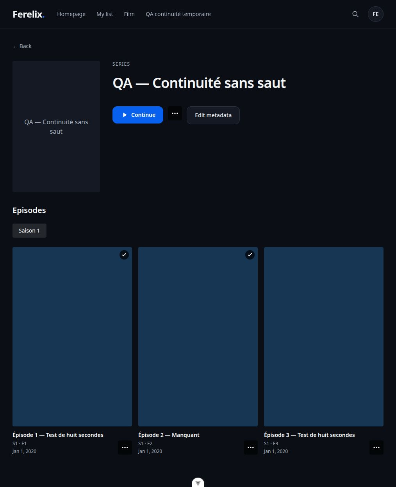

# Validation — métadonnées et continuité

## Résultat fonctionnel

Le catalogue éditorial, le statut vu par œuvre et la position par fichier sont désormais indépendants. Les cas suivants sont couverts par des tests de régression :

| Situation | Comportement vérifié |
|---|---|
| 89,99 %, 90 %, 100 % ; durée inconnue | Un seul seuil serveur, égalité incluse ; durée inconnue jamais suffisante. |
| Modification du seuil | Appliquée aux prochains événements, sans enlever les coches ni réinterpréter les reprises à la lecture. |
| « Non vu » puis ancien heartbeat/close | Révision obsolète refusée ; la position et l'intention récente restent intactes. |
| Lectures simultanées, éditions différentes | La session la plus récente possède l'écriture ; aucune conversion de position entre éditions. |
| Relecture d'une œuvre vue | Coche conservée et reprise active possible. |
| E1 disponible, E2 manquant, E3 disponible | Trois fiches visibles, E2 bloque et E3 n'est jamais substitué. |
| Fichier disparu pendant le compte à rebours | Revérification serveur, refus du lancement ; aucun épisode ultérieur de secours. |
| Série terminée depuis un an, nouvelle saison disponible | Nouvelle fenêtre d'affichage pour le prochain épisode requis. |
| Expiration, heartbeat en pause, rescan, seconde édition | Historique conservé ; aucune fausse réactivation. |
| Série marquée vue puis nouvelle saison annoncée | Seuls les épisodes connus lors du marquage sont vus. |
| Spéciaux, catalogue incomplet, trous E1/E3 ou saisons 1/3 | Ordre incertain, continuation automatique refusée. |
| Fichier multi-épisodes sans bornes fiables | Pas de découpage inventé ni de progression individuelle automatique. |
| Édition admin pendant téléchargement | Révision/génération/locks empêchent l'écrasement tardif, y compris images et valeurs vides. |
| Identifiant IMDb explicite et titre trompeur | Résolution stricte par identifiant TMDB ; aucune recherche par titre de secours. |
| Export NFO puis refresh fournisseur | L'export interne inchangé ne fige pas les anciennes métadonnées. |
| IDs explicites contradictoires avec même titre/année | Deux œuvres distinctes, aucun historique partagé par erreur. |
| Nom d'épisode mal formé en tête du backlog | Placeholder à identifier, les fichiers suivants sont tout de même traités. |
| Suppression d'un fichier ou d'une bibliothèque imbriquée | Historique conservé ; accès par bibliothèque parente préservé. |

Le marquage groupé de 103 épisodes utilise au plus **12 instructions SQL**, confirmation et authentification incluses. Un test SQLite concurrent avec deux sessions confirme une application entière et un conflit 409, sans mise à jour partielle.

## Vérification dans le navigateur

Une bibliothèque temporaire avec trois épisodes a été créée localement ; ses vidéos H.264/AAC durent **8 secondes**. E2 était initialement absent.

1. La fiche affiche E1, E2 manquant et E3.
2. Lecture réelle de E1 en **DirectPlay** jusqu'à son terme : message indiquant E2 manquant, aucun E3 lancé.
3. Ajout du fichier E2 : nouvelle lecture de E1, affichage du compte à rebours de 10 secondes, puis lancement effectif de E2.
4. Annulation du compte à rebours suivant : E3 ne démarre pas.
5. Retour à la fiche : coches en haut à droite pour E1/E2, dates et menus accessibles.

Le rechargement navigateur révélait aussi une ancienne session restant `active` : le démontage Vue n'est pas garanti à la fermeture du document. Le traitement de `pagehide` ferme maintenant cette session par requête `keepalive`. Vérification réelle avant/après rechargement : **`active` → `ended` immédiatement**, sans attendre l'expiration du droit de lecture. Le retour via le cache de navigation reconstruit une session, avec position et intentions de lecture conservées ; ce cas est couvert par les tests web.

Les sessions ont été fermées puis les seules données de test ont été supprimées. Aucun transcodage de long métrage n'a été effectué. Les fichiers temporaires et leur historique ne restent pas dans la bibliothèque utilisateur.



## Mesures reproductibles

```bash
cd server
uv run python -m scripts.benchmark_viewing --series 100 --episodes 24 --movies 1000 --iterations 20 --output /tmp/viewing-benchmark.json
```

Le script crée une base SQLite temporaire : 100 séries × 24 épisodes et 1 000 films, soit 3 600 fiches logiques et 3 400 fichiers. Une chauffe puis 20 mesures par opération ; p95 au rang le plus proche. Les mesures HTTP incluent ASGI, authentification et sérialisation, sans réseau réel. Aucun appel fournisseur, scan ni FFmpeg. Les chiffres sont locaux, synthétiques, et ne constituent pas une garantie de p95 en production.

| Opération | Médiane (ms) | p95 (ms) | Requêtes SQL |
|---|---:|---:|---:|
| HTTP « Reprendre », 50 cartes | 20,736 | 24,457 | 7 |
| HTTP « À suivre », 50 cartes | 78,700 | 173,508 | 15 |
| HTTP heartbeat | 6,920 | 9,291 | 9 |
| Projection d'une carte | 4,636 | 5,992 | 4 |
| Projection de 50 cartes | 5,849 | 9,931 | 4 |
| HTTP catalogue, 50 cartes | 12,223 | 19,058 | 6 |
| Ancienne projection physique, 50 cartes sans enrichissement | 1,521 | 1,911 | 1 |
| Même projection avec enrichissement éditorial | 3,389 | 5,602 | 2 |

L'enrichissement ajoute **1,868 ms de médiane et une requête** pour 50 cartes dans ce jeu. Ce coût est explicite ; ce changement n'est pas présenté comme une accélération de l'ancien catalogue. La projection légère n'hydrate pas synopsis/distributions, et son nombre de requêtes ne croît pas de 1 à 50 cartes.

### Optimisation mesurée de « À suivre »

La première implémentation regroupait les enfants en reparcourant tous les épisodes pour chaque série. Le profilage a montré une boucle quadratique. Le regroupement est maintenant construit en un passage, avant le choix logique de l'épisode.

| Mesure, mêmes données et 20 appels | Avant regroupement | Après | Variation |
|---|---:|---:|---:|
| Médiane HTTP (ms) | 218,623 | 78,700 | −64,0 % |
| p95 HTTP (ms) | 313,716 | 173,508 | −44,7 % |
| CPU du processus, total 20 appels (ms) | 4 549,699 | 1 844,850 | −59,5 % |
| Requêtes SQL par appel | 15 | 15 | inchangé |
| Accès aux attributs ORM, profil de cinq appels | 5 856 305 | 326 430 | −94,4 % |

Cette comparaison porte **uniquement sur l'optimisation de cette nouvelle fonction**, pas sur les performances globales de l'ancienne version du serveur. Les variations des autres opérations entre les deux exécutions ne sont pas attribuées à ce changement. L'inventaire complet des séries suivies reste nécessaire pour détecter les trous ; le travail reste proportionnel à cet inventaire.

Les [mesures avant](metadata-viewing-before-grouping.json), [mesures finales](metadata-viewing.json) et le [patch exact du regroupement](metadata-next-up-grouping.patch) sont conservés. Pour reproduire la variante initiale, appliquer ce patch à l'envers dans une copie jetable, exécuter le même benchmark, puis réappliquer le patch.

### Appels fournisseurs

Les tests contrôlés comptent les requêtes : deux recherches AniDB partagent un seul téléchargement du catalogue de titres ; deux récupérations de la même illustration utilisent un seul téléchargement ; une deuxième tentative pendant un refus AniDB persistant n'émet pas de nouvelle requête. Les caches sont conservés en base, y compris après redémarrage.

**Aucun identifiant TMDB/AniDB n'est configuré dans cette installation locale.** Les réponses, erreurs et délais fournisseurs sont donc testés avec des données contrôlées ; aucun succès d'identification distante réelle n'est revendiqué. La configuration est décrite dans [le guide](../../metadata-and-viewing.md).

## Migration et contrôles

- **524 tests serveur**, **175 tests web** passent.
- Ruff, formatage Python, BasedPyright, vue-tsc, Biome, génération OpenAPI et build web passent.
- Les quatre tests locaux du lanceur passent également ; les modifications préexistantes de `dev/` sont exclues de la PR.
- [Migration aller-retour](metadata-migration.json) sur une copie de la base locale : quatre fichiers, un compte et une progression conservés, positions/compteurs inchangés, aucune violation de clé étrangère.
- Bundle principal : 248,22 kB (84,21 kB gzip). Lecteur chargé à la demande : 638,13 kB (197,82 kB gzip) ; éditeur : 19,90 kB (5,81 kB gzip). Le build conserve l'avertissement de taille du chunk lecteur.

Le lecteur a été vérifié avec des médias courts en DirectPlay. Les tests de cycle de session/HLS/transcodage existants passent, mais ce lot ne prétend pas mesurer un nouveau gain d'encodage ou valider une installation distante.
