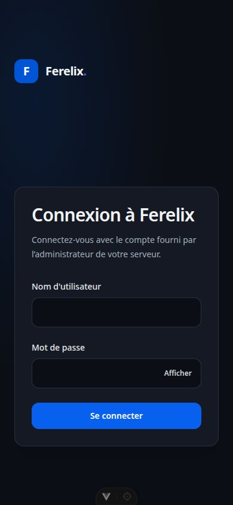
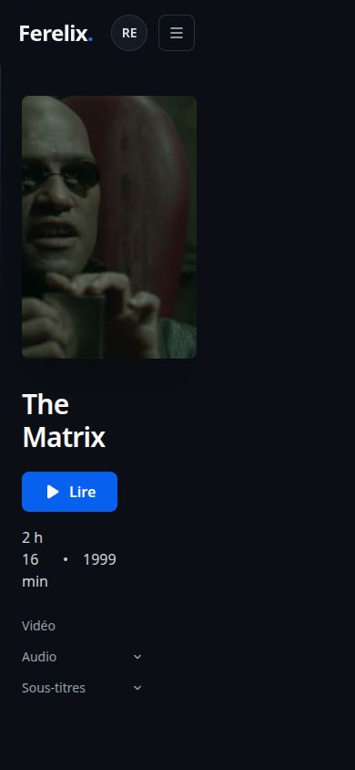
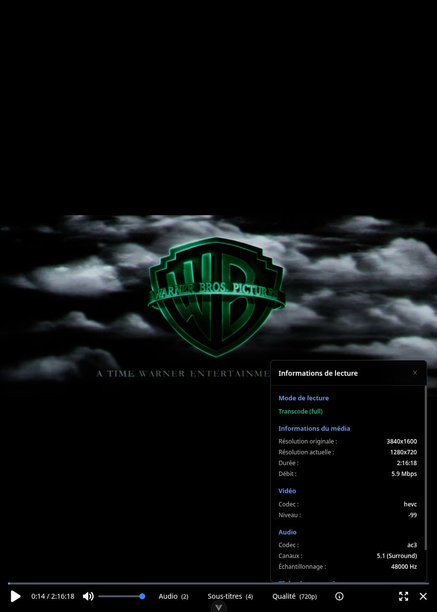
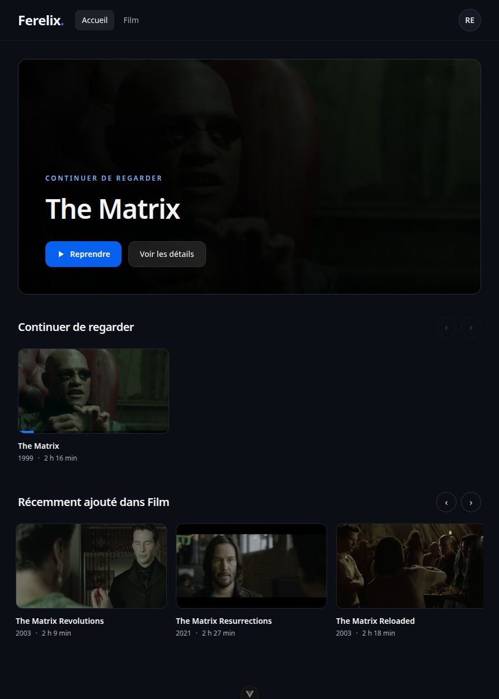

# Ferelix — second lot : lecture, architecture et expérience utilisateur

Lot du 7 novembre 2026, sur `db5fede`, qui contient les corrections et mesures du [premier audit](../2026-11-06/review.md). Les deux lots sont réunis dans la première PR. Les modifications préexistantes de `dev/` sont préservées hors de cette PR.

## Suivi des recommandations

| Recommandation du premier audit | Mise en œuvre et vérification |
| --- | --- |
| Session propriétaire obligatoire et intentions cohérentes | Démarrage anonyme refusé, fermeture concurrente et anciennes intentions sans processus orphelin |
| Avance d'encodage bornée | Pause/reprise réelle de FFmpeg avec hystérésis, mesure courte CPU/octets/avance |
| Auth média indépendante du JWT général | URL native encore valide après expiration du JWT, puis refus après fermeture/expiration du bail/révocation |
| Mutations réseau bornées | Délai dépassé sans file lecteur bloquée ni job ressuscité |
| Orchestration du lecteur séparée des contrôles | Composable dédié, tests de changements qualité/audio/seek et fermeture |
| Dashboard découpé aux invariants métier | Services comptes et domaines cohérents, endpoints et permissions préservés |
| Catalogue léger, paginé, homepage sans N+1 | Mesures SQL/JSON sur 10 000 médias et chargement à la demande |
| Révocation des anciens credentials | Ancien refresh/access/media token refusé après changement ou réinitialisation |
| Unicité des identités normalisées | Contrainte DB, test de concurrence, migration refusant les collisions sans supprimer d'utilisateur |
| Piste vidéo réellement choisie | Index transmis du menu au plan et au mapping FFmpeg |
| ffprobe défaillant non destructif | Anciennes pistes et métadonnées conservées, erreur enregistrée, nouvel essai possible |
| Annulations conservées et rétention bornée | Événement scheduler ne réécrit pas cancelled; 100 états terminés retenus |
| Capacités et options réellement honorées | HDR/10-bit prudent, codec tag, stream copy et interdictions de méthodes testés |
| Routes chargées à la demande | Taille du bundle initial séparée de la somme des chunks |
| Un seul propriétaire du runtime | Docker fixe un worker; contrainte documentée pour déploiements personnalisés |
| Cohérence UI et authentification | Navigation sémantique, formulaires accessibles, retour après connexion, états vides/erreurs, mobile |

Les éléments de ce tableau sont implémentés dans ce lot. Les garanties concurrentes sont testées dans `test_playback_intents.py`, `test_playback_lifecycle.py` et `test_playback_media_access.py`; les options dans `test_playback_negotiation.py`; les comptes dans `test_account_credentials.py` et `test_account_migration.py`; le catalogue dans `test_catalogue_cards.py`; le scanner et les tâches dans `test_scanner.py` et `test_jobs_service.py`. Le front couvre les intentions de lecture, erreurs réseau, refus d'autoplay, requêtes tardives entre comptes, pagination et interactions clavier dans ses tests Vitest.

## Scanner et tâches : comparaison exécutée

Le [benchmark reproductible](../../../server/scripts/benchmark_background_resilience.py) charge le code précédent au commit `db5fede` et le code courant. Il utilise SQLite en mémoire, un fichier factice et un échec ffprobe injecté : aucun transcode n'est lancé. [Résultats bruts](background-resilience.json).

| Scénario | Avant | Après |
| --- | --- | --- |
| Deux pistes existantes, échec ffprobe lors d'un rescan | 0 piste conservée, durée effacée, fausse mise à jour réussie | 2 pistes conservées, durée 120 s inchangée, erreur explicite |
| Annulation coopérative puis événement de succès APScheduler | État final `success` | État final `cancelled` |
| 1 000 tâches ponctuelles terminées | 1 000 états conservés | 100 états conservés (−90 % sur cette simulation); tâches en attente/actives préservées |

Les tests couvrent aussi timeout, JSON invalide, absence de vidéo, nouvel essai après erreur et poursuite du scan des autres fichiers. Cette mesure porte sur la conservation des données et le nombre d'états, pas sur un gain CPU.

## Catalogue : comparaison exécutée

Le [benchmark catalogue](../../../server/scripts/benchmark_catalogue.py) appelle les véritables routes ASGI authentifiées, avec SQLite sur disque et 10 000 médias synthétiques (1 piste vidéo, 2 audio et 3 sous-titres par film). Sept essais alternent l'ancien code `db5fede` et le nouveau, cache chaud; les identifiants retournés sont comparés. [Échantillons et méthode](catalogue.json).

| Opération | Avant | Après |
| --- | --- | --- |
| Page de 48 cartes : requêtes SQL, auth comprise | 6 | 2 |
| Page de 48 cartes : JSON | 78 303 octets | 14 883 octets, −81,0 % |
| Page de 48 cartes : durée médiane ASGI | 11,615 ms | 3,957 ms, −65,9 % |
| Accueil de 20 rangées × 24 cartes : SQL, auth comprise | 102 | 3 |
| Accueil : JSON | 791 961 octets | 152 172 octets, −80,8 % |
| Accueil : durée médiane ASGI | 200,356 ms | 49,603 ms, −75,2 % |

Il s'agit de temps de traitement locaux avec des métadonnées synthétiques, sans réseau ni FFmpeg, pas d'une mesure CPU ni d'une promesse de latence en production. Les cartes ne transportent plus les pistes détaillées; celles-ci sont chargées sur la fiche et dans le lecteur. L'onglet catalogue charge 48 cartes plus un élément de détection de page suivante à la demande, au lieu de récupérer toute la bibliothèque. Le chargement initial des 10 000 films n'est donc plus nécessaire.

Un autre défaut est couvert par un test : la rangée « À reprendre » pouvait être vide après avoir limité les candidats puis écarté les films presque terminés. Le filtre de complétion est désormais appliqué avant la limite SQL. Avec 9 films à 95 % et un film plus ancien à 10 %, une limite de 1 renvoie bien le film encore en cours.

## Vérifications d'interface

Parcours exécutés dans le navigateur local avec un compte de test et une copie de la base : connexion refusée avec message et focus sur le champ, connexion réussie, accueil, bibliothèque/recommandations/catalogue, fiche du film, paramètres, déconnexion, puis retour exact à `/media/1?libraryId=1` après réauthentification. À 390 × 844 px, la fiche a une largeur de document de 390 px : aucun débordement horizontal global. Les rangées se parcourent horizontalement à l'intérieur de leur zone.

## Régulation de l'avance d'encodage

Deux essais de dix secondes utilisent une vraie source HEVC 4K, en copie vidéo avec conversion audio AAC. Le spectateur simulé reste en pause puis avance de 90 secondes à la sixième seconde. Le [script](../../../server/scripts/benchmark_encoding_ahead.py) utilise les commandes, le parseur et le régulateur de l'application, sans DB ni API, et impose un arrêt de secours et un nettoyage. [Résultats bruts](encoding-ahead.json).

| Mesure | Sans régulation | Avec régulation |
| --- | --- | --- |
| CPU FFmpeg échantillonné à 10 s | 13,22 s | 3,79 s, −71,3 % |
| Vidéo produite à 10 s | 799,27 s | 211,22 s |
| Fichiers produits après arrêt/flush | 390 415 632 octets | 162 329 353 octets, −58,4 % |
| Avance maximale observée, flush compris | 718,55 s | 130,46 s |

La pause intervient à 1,702 s avec 122,17 s d'avance. Entre 2 et 6 s, le CPU cumulé reste à 2,23 s : aucun travail CPU supplémentaire n'est observé. À l'avance du playhead, le processus reprend à 6,016 s, puis se suspend à 7,218 s. Les deux processus sont arrêtés et récupérés normalement, les dossiers supprimés. C'est un essai par mode, pas une estimation statistique générale ni un gain d'efficacité de l'encodeur. Le seuil de 120 s comporte un dépassement dû aux buffers, à la périodicité de mesure et au flush. La pause n'intervient qu'après production du premier segment exploitable.

## Contrat du lecteur et régressions

Tous les démarrages sont rattachés à une session et un propriétaire. Une génération monotone est revendiquée côté serveur; les intentions dépassées, y compris les heartbeats, ne peuvent plus réaffecter la session à un ancien job. Les tests concurrents utilisent SQLite sur disque et vérifient deux démarrages, un DELETE en attente et le rejet d'une génération rejouée. Les valeurs non finies ou négatives de progression sont refusées avec une réponse 422 sérialisable. Un arrêt échoué ne renvoie plus un faux succès.

Les URL de média contiennent un jeton opaque limité au film et à la session; seul son hash est enregistré. Il reste utilisable au-delà de l'expiration du JWT général tant que le bail de heartbeat est valide, puis est refusé après fin de session ou révocation des credentials. La reprise de requêtes API est également bornée. La négociation transmet réellement les pistes audio/vidéo, respecte les interdictions de copie/transcode et peut conclure explicitement qu'aucune méthode n'est autorisée. Les capacités HDR/10-bit du navigateur ne sont plus inventées; cette prudence peut nécessiter un transcode lorsqu'un navigateur ne confirme pas sa compatibilité.

Le test navigateur réel a démarré Matrix, changé de qualité, progressé, mis en pause et fermé le lecteur. Il a révélé un défaut de taille : le SAR pouvait faire annoncer 1 282 pixels pour une cible maximale de 1 280. Le facteur commun et le SAR corrigés donnent **1 280 × 532, SAR 1:1**, vérifiés par FFmpeg et par `videoWidth`/`videoHeight` dans le navigateur. Le dernier essai s'est fermé normalement (stop 200, session 204), sans processus restant. Les essais exploratoires précédents ont été interrompus par le limiteur de test à 30,1 s; ils ne sont pas comptés comme preuve d'arrêt normal.

Une nouvelle série de sept transferts HTTP de 128 Mio sur la version courante donne **0,07 s CPU serveur et 0,0994 s écoulée** en médiane ([échantillons](direct-stream-final.json)); le gain initial par rapport à 0,45 s CPU est conservé malgré le contrôle de session supplémentaire. Fichier en cache, boucle locale, un seul client, CPU du client exclu.

## Chargement du web

Le build Vite est mesuré en JavaScript minifié et gzip, en additionnant les dépendances statiques de chaque route sans compter les imports dynamiques des autres routes. [Méthode, chunks et valeurs exactes](web-bundle.json).

| Code nécessaire | Ancien bundle chargé partout | Nouveau build |
| --- | --- | --- |
| Entrée commune | 979,20 Ko / 301,60 Ko gzip | environ 224,1 Ko / 77,8 Ko gzip |
| Accueil et dépendances | 979,20 Ko / 301,60 Ko gzip | environ 238,4 Ko / 84,2 Ko gzip, −72 % gzip |
| Lecteur et dépendances | 979,20 Ko / 301,60 Ko gzip | environ 857,2 Ko / 274,3 Ko gzip |
| Somme de tous les chunks | 979,20 Ko / 301,60 Ko gzip | environ 993,0 Ko / 316,8 Ko gzip |

Le gain vient principalement du chargement différé de HLS et de l'administration. Le poids total augmente légèrement; ce changement ne promet ni −72 % de CPU ni −72 % de temps de rendu. CSS, images et temps d'exécution sont exclus de cette mesure. Le chunk lecteur reste conséquent puisqu'il contient HLS.js.

## Migrations et limites

La chaîne `account_credentials` → `playback_access` → `media_scan_diagnostics` suit `add_media_file_modified_at`. Un aller-retour upgrade/downgrade/upgrade sur une copie de la bibliothèque réelle conserve 1 utilisateur, 4 médias, 4 pistes vidéo, 9 audio et 14 sous-titres, avec zéro violation de clé étrangère ([preuve](migrations.json)). Les collisions d'identité sont signalées avant modification du schéma; aucun compte n'est supprimé automatiquement.

Le serveur reste à **un worker** : l'exclusion des encodeurs et la coordination des scans ne constituent pas des verrous distribués. Les migrations s'appliquent avant de démarrer le nouveau serveur et les clients doivent adopter session, jeton média et génération. Le web est mis à jour avec le schéma OpenAPI. Safari/HLS natif, Android TV, HDR matériel et un film entier ne sont pas validés par les essais locaux courts.

## Validation finale locale

**348 tests serveur et 100 tests web passent.** Ruff, basedpyright, Biome, vue-tsc, génération OpenAPI/TypeScript, build Vite et `git diff --check` passent. Le build conserve son avertissement pour le chunk différé du lecteur, supérieur à 500 Ko. Les quatre tests du lanceur présents dans le checkout passent également; les changements préexistants de `dev/` restent hors de la PR.

La QA finale a aussi vérifié le déplacement avec les touches Flèche droite et PageUp : la cible passe à 13:39 en conservant l'intention de pause, puis la session est fermée. L'ouverture de la modale bibliothèque place le focus dans « Nom », Échap la ferme et rend le focus au bouton déclencheur (le retour initial à BODY a été corrigé). Les refus d'autoplay et leurs rejets tardifs, ainsi que la pause pendant changement de source, ont leurs tests de régression.

## Références d'interface

Les principes retenus sont une navigation stable, des rangées de contenus réels, une action de lecture identifiable et des paramètres séparés de la découverte. Références primaires : [navigation Plex](https://support.plex.tv/articles/navigating-the-mobile-apps/), [My List Netflix](https://help.netflix.com/en/node/10523), [Web Interface Guidelines](https://github.com/vercel-labs/web-interface-guidelines/blob/main/command.md). Aucun logo ni faux catalogue de ces services n'est intégré.
